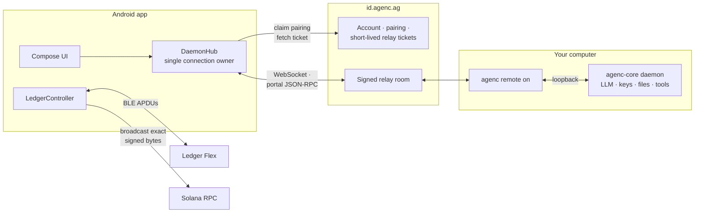

<div align="center">

<picture>
  <source media="(prefers-color-scheme: dark)" srcset="app/src/main/res/drawable-nodpi/agenc_mark.png">
  <source media="(prefers-color-scheme: light)" srcset="branding/agenc-logo.svg">
  
</picture>

# AgenC Android

**Your coding agent in your pocket. Your keys in your Ledger.**

Native Kotlin / Jetpack Compose remote control for [AgenC](https://agenc.tech) agent sessions
running on your computer — with hardware-approved Solana transfers from a Ledger Flex over
Bluetooth LE.

<p>
  
  
  
  
  
</p>

<a href="https://agenc.tech">Website</a> ·
<a href="https://github.com/tetsuo-ai/agenc-core">AgenC Core</a> ·
<a href="https://github.com/tetsuo-ai/agenc-ios">iOS App</a> ·
<a href="#documentation">Documentation</a>

</div>

---

## Overview

AgenC Android pairs your phone with a computer running the
[AgenC Core](https://github.com/tetsuo-ai/agenc-core) daemon. Once paired, you can read and
drive every agent session from anywhere: send prompts, watch answers stream in, approve tool
use, reply to elicitations, and get notified the moment a long-running turn finishes.

The trust model is deliberate:

- **The computer keeps the intelligence.** The LLM, provider API keys, files, tools, and
  daemon never leave your machine. The phone is a remote control, not a second brain.
- **The Ledger keeps the keys.** Solana transfers requested in chat are signed only after
  physical review and approval on a Ledger Flex. Private keys never touch the phone, the
  computer, or the model.

The app shares its backend and relay protocol with [AgenC iOS](https://github.com/tetsuo-ai/agenc-ios)
and is feature-matched to it.

## Features

### 🖥️ Remote session control

- **Pair in seconds** — scan a QR code or type an eight-character code from `agenc remote on`;
  an `agenc://pair?c=...` deep link prefills the code without auto-submitting.
- **Streaming chat** — live token streaming with stable user → assistant grouping, animated
  entry, jump-to-latest, long-press message actions, and Markdown rendering.
- **Tool permissions from your phone** — allow once, allow for the session, deny, or answer
  typed elicitations. Replies are dispatched preemptively so they never deadlock behind the
  turn they unblock.
- **Sessions at scale** — searchable session list, live lifecycle state, per-session mute,
  and swipe-to-delete that only removes the row after Core confirms.
- **Intelligent notifications** — completion and needs-attention alerts with exact-session
  deep links, quiet hours, per-session mute, a minimum-duration threshold, and replay-safe
  deduplication. A single status capability delivers cross-session updates without attaching
  every transcript, so it scales to hundreds of sessions.
- **Background continuity** — an eligible foreground service keeps the authenticated relay
  link alive while the app is backgrounded, and stands down when you return.
- **Account integrity** — the hosted login and the Core `/login` identity are reconciled
  explicitly; conflicting identities surface as a visible `ACCOUNT MISMATCH` instead of being
  silently merged.

### 🔐 Hardware-approved transfers (`@ledger`)

- **Ledger Flex over BLE** — associate a device once; the app reconnects directly, reads the
  running Ledger app, and opens the stock Solana app on its own when needed.
- **Deterministic account discovery** — scans the common Solana derivation families
  (`44'/501'/N'/0'`, `44'/501'/N'`, `44'/501'/0'/N'`) with paging, plus exact-index lookup up
  to 1,000,000 for wallets outside the fast page.
- **One strict, typed protocol** — Core emits a single expiring `ledger_solana_transfer_v1`
  action. Unknown fields, malformed addresses, non-canonical amounts, and stale or over-TTL
  requests are rejected outright. The action can never choose the source wallet — that is
  bound locally to your saved default.
- **Physical approval, always** — the source, recipient, and amount are verified on the Flex
  screen. Reject on-device and Core receives a typed cancellation; nothing is signed.
- **Crash-safe by construction** — a one-shot hardware fence guarantees the same intent can
  never produce a second signing prompt; retries rebroadcast the exact persisted signed bytes
  rather than re-signing; receipts are durable, replay-safe, and bound to the paired host.
- **Independent verification** — every submitted transfer links to Solscan by signature.

### 📱 Built like a product

- Single-activity Jetpack Compose app with a monochrome Material 3 design system, haptic
  feedback, and a violet accent reserved exclusively for `@ledger` semantics.
- CameraX + ML Kit QR scanning, OkHttp WebSockets, kotlinx-serialization, and encrypted
  storage — no heavyweight frameworks.
- A JVM contract and state-machine test suite guards the protocol, notification policy,
  identity linking, and Ledger safety invariants.

## Architecture



Relay frames use the portal `{ "t": "data" }` envelope. Inside it, Core speaks JSON-RPC:
`initialize`, `session.list`, `session.attach`, `message.send`, `tool.approve`,
`elicitation.respond`, and event notifications. A direct loopback daemon endpoint exists for
development; production pairing always goes through the signed relay room.

The client advertises two authenticated capabilities:

| Capability | Purpose |
| --- | --- |
| `portal.mobile.status.push.v1` | Cross-session status delivery without attaching every transcript |
| `portal.ledger.solana.sign.v1` | Receiving exactly one typed Ledger action on a capable phone |

Older Core builds still pair and chat normally — the newer paths simply stay unused.

## Security model

- **Private keys never leave the Ledger.** The phone builds transactions and transports
  APDUs; only the hardware device signs, and only after physical review.
- **Provider credentials never leave the computer.** The app does not run the model and never
  receives an API key.
- **Secrets are encrypted at rest.** Bearer tokens and relay tickets live in encrypted
  Android storage; everything else stored on the device is non-secret metadata.
- **Backups are refused.** Cloud backup and device-to-device transfer are disabled — a new
  phone must authenticate, pair, and select a wallet again. An authenticated pairing or
  financial recovery state can never be inherited.
- **Signing is fail-closed.** A monotonic fence committed before the first signing APDU makes
  double-prompting impossible; ambiguous RPC outcomes keep the exact signed bytes and enter a
  recovery state instead of re-signing. Terminal receipts are append-only, and a delayed
  cancellation can never overwrite `submitted`.
- **Replay is inert.** A durable FIFO action inbox with per-intent tombstones means replayed
  relay or Core frames cannot resurrect a signing prompt.
- **Scope is intentionally narrow.** Ledger v1 supports native SOL transfers on
  `mainnet-beta` only — no SPL tokens, swaps, staking, arbitrary programs, or model-chosen
  source wallets.

The full protocol, fence ordering, receipt schema, and recovery rules are specified in
[docs/LEDGER_FLEX.md](docs/LEDGER_FLEX.md).

## Getting started

### What you need

- A computer running a compatible AgenC Core daemon with `agenc remote on`
- An AgenC account, signed in on both the computer and the phone
- A provider/model/key configured on Core (the phone never runs the model)
- Android 8.0+ (API 26) on the phone
- *Optional:* a Ledger Flex with the stock Solana app, for `@ledger`

### 1 · Pair your computer

```sh
# On the computer
agenc login
agenc remote on        # displays a QR code and an eight-character pairing code
```

On the phone: sign in, then scan the QR or type the code. The backend claims the single-use
pairing, issues a short-lived relay ticket, and the app joins the same signed relay room as
your computer. Sessions and status begin syncing immediately.

### 2 · Associate a Ledger Flex *(optional)*

1. Open **Account → Ledger Flex** and unlock the Flex with Bluetooth enabled.
2. Select the device; the app opens the Solana app on the Ledger automatically.
3. Pick one derived account as AgenC's default source wallet.

### 3 · Request a transfer from chat

In the root chat on Core, mention `@ledger` as an exact token with an unambiguous recipient
and amount:

```text
@ledger send 0.05 SOL to <solana-address>
```

The phone shows the request, the Flex shows the source, recipient, and amount, and you
approve or reject **on the hardware**. Core receives a typed receipt either way, and the chat
renders a violet transfer row with a Solscan link. `submitted` means the RPC accepted the
exact signed bytes — the receipt explicitly does not claim finality.

## Building from source

| Component | Version |
| --- | --- |
| JDK | 21 recommended (source/target 17) |
| Gradle wrapper | 8.11.1 |
| Android Gradle Plugin | 8.7.3 |
| Kotlin | 2.0.21 |
| Compile / target SDK | 35 |
| Min SDK | 26 |
| Compose BOM | 2024.12.01 |

Point `sdk.dir` at your Android SDK in a machine-local `local.properties` (never committed),
then run the full local gate:

```sh
./gradlew testDebugUnitTest lintDebug assembleDebug
```

Install the debug APK on an explicitly selected device:

```sh
adb devices -l
adb -s <serial> install -r app/build/outputs/apk/debug/app-debug.apk
adb -s <serial> shell am start -n ai.tetsuo.agenc/.MainActivity
```

See [docs/DEVELOPMENT.md](docs/DEVELOPMENT.md) for package-scoped log capture, the manual
verification matrices, the safe no-broadcast Ledger rehearsal, and the release checklist.

## Project structure

```text
app/src/main/java/ai/tetsuo/agenc/
├── MainActivity.kt     Lifecycle, routes, notification deep links, Ledger recovery wiring
├── AppConfig.kt        Backend/relay endpoints and permission-mode wire values
├── data/               Auth, secure/local state, session reducer, daemon/relay hub
├── net/                JSON-RPC connection and strict portal event adapter
├── notif/              Foreground link service, local notifications, action receiver
├── ledger/             BLE transport, Solana APDUs/accounts/transactions, controller
├── model/              Domain, transcript, typed Ledger action/result models
└── ui/
    ├── Theme.kt        Monochrome design tokens
    ├── screens/        Login, Pairing, Home, Sessions, Account, Ledger
    └── chat/           Chat, composer, Markdown, actions, permission/input sheets

app/src/test/           JVM contract and state-transition tests
branding/               Canonical AgenC SVG source and asset provenance
docs/                   Protocol, UX, Ledger, and development references
```

## Testing

The JVM suite covers the parts that must never regress silently: connection single-flight,
status deduplication and terminal ordering, identity linking, notification and background
policies, strict action/receipt parsing, the durable inbox/tombstone/fence/outbox machinery,
host-exit rules, and Ledger account derivation.

```sh
./gradlew testDebugUnitTest
```

No automated test ever sends a transaction. Hardware verification follows the scripted
no-broadcast rehearsal in [docs/DEVELOPMENT.md](docs/DEVELOPMENT.md): request, review on the
Flex, **reject on-device**, and confirm the typed cancellation — nothing is signed or
broadcast.

## Permissions

| Permission | Used for |
| --- | --- |
| Internet / network state | Backend, relay, Core, and Solana RPC |
| Notifications | Completion, attention, and foreground-link status |
| Foreground service (remote messaging) | Keeping the authenticated Core link alive in background |
| Camera | Pairing QR scan (optional) |
| Bluetooth scan / connect | Ledger Flex discovery and APDU transport (optional) |
| Legacy Bluetooth / location (API ≤ 30) | Platform BLE compatibility only |
| Vibration | Haptic feedback |

Camera and BLE are declared as optional hardware features; sensitive runtime permissions are
requested only when their feature is actually used.

## Compatibility

| Core | Android | Behavior |
| --- | --- | --- |
| old | new | Basic pairing and chat; no global status, all-tools promotion, or typed Ledger actions |
| new | old | Attachment-bound chat remains compatible; unadvertised capabilities stay unused |
| new | new | Full background status, account reconciliation, permission, and Ledger paths |

Deploy or restart Core before shipping a build that relies on the newer capabilities.

## Documentation

| Document | Covers |
| --- | --- |
| [docs/REMOTE_CONTROL.md](docs/REMOTE_CONTROL.md) | Pairing, connection ownership, notifications, permission settlement, identity linking |
| [docs/LEDGER_FLEX.md](docs/LEDGER_FLEX.md) | The `@ledger` protocol, hardware fence, typed receipts, replay and recovery safety |
| [docs/UX_BEHAVIOR.md](docs/UX_BEHAVIOR.md) | The UX acceptance contract |
| [docs/DEVELOPMENT.md](docs/DEVELOPMENT.md) | Toolchain, local gates, device installs, logs, release checklist |
| [branding/README.md](branding/README.md) | Brand assets and asset-derivation rules |

## Status

Current build metadata: `ai.tetsuo.agenc`, `versionName 0.1`, `versionCode 1` — an early,
actively developed release. There is no hosted CI or store pipeline yet; the local Gradle
gates plus the manual device matrices in [docs/DEVELOPMENT.md](docs/DEVELOPMENT.md) are
authoritative, and a distributable release requires a version bump and the project-approved
signing/AAB process. `Demo.ENABLED` must remain `false` in every distributed artifact.

## Ecosystem

| Project | Role |
| --- | --- |
| [agenc-core](https://github.com/tetsuo-ai/agenc-core) | The daemon and CLI that own sessions, tools, files, and provider credentials |
| [agenc-ios](https://github.com/tetsuo-ai/agenc-ios) | The iOS counterpart — same backend, relay protocol, and product surface |
| **agenc-android** | This repository |

---

<div align="center">

Built by <a href="https://github.com/tetsuo-ai">Tetsuo AI</a> · <a href="https://agenc.tech">agenc.tech</a>

</div>
